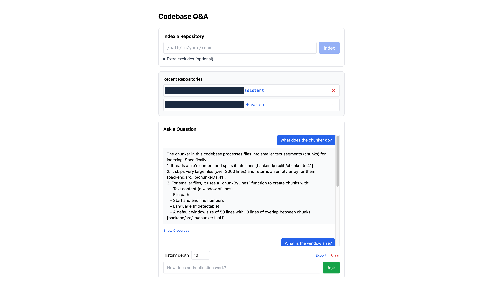

# RAG Codebase Q&A

A local-first developer tool that answers natural language questions about any codebase with cited source references. Ask "what does the auth system do?" and get streamed answers with file:line citations.



**Built with:** Python (FastAPI + Chroma), Node.js (Hono), React + Vite, Vercel AI SDK

## Why This Matters

- **No external APIs for embeddings** - `sentence-transformers` runs locally on CPU, fully private
- **Multi-provider LLM support** - switch between Claude, Gemini, Mistral, GPT without code changes
- **Streaming UI** - answers appear token-by-token with citations, no waiting
- **Language-agnostic chunking** - 50-line windows work for any code or prose
- **Cited answers** - every response links back to source files and line numbers

## Architecture

```
┌─────────────────────────────────────────────────────────────────┐
│ React Frontend (port 5173)                                      │
│ • RepoIndexer: path input → index button                        │
│ • ChatInterface: question input → streaming answer + sources    │
└─────────────────────┬───────────────────────────────────────────┘
                      │ (HTTP + SSE)
┌─────────────────────▼───────────────────────────────────────────┐
│ Node.js Backend (port 3001, Hono)                              │
│ • POST /ingest: walk files → chunk → send to Python service    │
│ • POST /query: retrieve chunks → build context → stream LLM    │
└─────────────────────┬───────────────────────────────────────────┘
                      │ (HTTP)
┌─────────────────────▼───────────────────────────────────────────┐
│ Python Service (port 8001, FastAPI)                            │
│ • POST /ingest: embed chunks → upsert to Chroma               │
│ • POST /query: embed question → retrieve top-5 chunks         │
└─────────────────────────────────────────────────────────────────┘
```

**Separation of concerns:**

- Python: stateful ML (embeddings + vector store)
- Node.js: stateless orchestration (file walking, context building, streaming)
- React: interactive UI (real-time streaming feedback)

## Quick Start

Three services run in parallel:

```bash
# Terminal 1: Python embedding service (port 8001)
cd python-service
python3.12 -m venv venv
source venv/bin/activate
pip install -r requirements.txt
uvicorn main:app --port 8001 --reload

# Terminal 2: Node.js backend (port 3001)
cd backend
npm install
npm run dev
# Loads .env via tsx --env-file=.env

# Terminal 3: React frontend (port 5173)
cd frontend
npm install
npm run dev
```

Then open http://localhost:5173 and index any local repo.

## Configuration

Create `.env` in the project root:

```bash
cp .env.example .env
```

Edit `.env`:

```
LLM_PROVIDER=mistral
MISTRAL_API_KEY=<your-mistral-key>
PYTHON_SERVICE_URL=http://localhost:8001
```

Supported LLM providers:

- `anthropic` - Claude Sonnet 4.6 (default)
- `mistral` - Mistral Large
- `google` - Gemini 2.0 Flash
- `openai` - GPT-4o

## Example Flow

```
1. User enters repo path: /Users/you/my-app
2. Backend walks files, chunks them (50 lines + 10-line overlap)
3. Python service embeds chunks → stores in Chroma
   - Creates collection named "my-app"
   - Stores ~1000 chunks for typical project
4. User asks: "how does auth work?"
5. Backend retrieves top-5 similar chunks
6. LLM streams answer with [file:line] citations
7. Frontend shows collapsible sources
```

## Design Decisions

- **Chunking is language-agnostic**: 50-line windows work for Python, JS, Go, YAML, markdown, etc.
- **Streaming over polling**: SSE is simpler than WebSocket and natural for text generation
- **Python ↔ Node separation**: ML is stateful (Chroma), orchestration is stateless (restart-safe)
- **Local embeddings**: no rate limits, no API costs, fully private (all data stays on your machine)
- **Provider abstraction**: Vercel AI SDK hides ChatGPT/Claude/Gemini differences

## What's Included

- **50+ automated tests** for file walking and chunking logic
- **Error handling** for large files (>2000 lines skipped), missing paths, unavailable embeddings
- **Smart skip list**: ignores node_modules, dist, build, .git, minified files, binary assets
- **SSE streaming**: token-by-token answer delivery with `event: sources` metadata
- **CORS enabled**: frontend and backend can be on different origins
- **Path filtering**: honors `.gitignore` in the indexed repo, plus an optional "Extra excludes" textarea for ad-hoc per-ingest patterns

## Development

### Run tests

```bash
cd backend
npm run test  # vitest
```

### Manual smoke test

```bash
# With Python service running, test the ingest endpoint:
curl -X POST http://localhost:8001/ingest \
  -H "Content-Type: application/json" \
  -d '{"collection":"test","chunks":[{"text":"fn main(){}","file":"main.rs","startLine":1,"endLine":1,"language":"rust"}]}'
# → {"indexed":1}

# Query the chunks:
curl -X POST http://localhost:8001/query \
  -H "Content-Type: application/json" \
  -d '{"collection":"test","question":"what language is this?"}'
# → {"chunks":[...]}
```

## Working with AI agents

- [AGENTS.md](./AGENTS.md) - architecture, commands, conventions and the local-first rules for coding agents. `CLAUDE.md` imports it for Claude Code.
- Skills in `.claude/skills/`:
  - `add-ingest-filter` - add a skip/ignore/chunking rule with a fixture in `backend/test-fixtures/sample-repo` and a Vitest case.
  - `eval-answers` - ingest the sample repo, ask the questions in `scripts/eval-cases.json` and check the answers cite the expected files: `node scripts/eval-answers.mjs` (needs the Python service, the backend and an LLM key; `--check` only validates the case file).
- Hook in `.claude/settings.json`: after an agent edits a `backend/src/**/*.ts` file, `.claude/hooks/backend-check.sh` runs that file's sibling `*.test.ts` and `tsc --noEmit` on the whole project, and feeds any failure back to the agent.

## Known Issues

- **Collection-name collisions.** Each indexed repo becomes a Chroma collection named after its directory basename (e.g. `/work/proj` and `/play/proj` would collide). Re-indexing now _replaces_ a collection rather than merging, so indexing the second `proj` will delete the first one's chunks. Workaround: rename one of the directories before indexing. A proper fix is tracked as follow-up work.

## Conversation History & Repo History

**Multi-turn Q&A** — ask follow-ups without re-indexing. History is persisted per repo at `~/.rag-qa/history/<collection>.json` and survives page reloads.

**Conversation history (Frontend):**

- Scrollable turn list (question bubbles, answer blocks with collapsible sources)
- User-settable history depth (how many prior turns to send to the LLM; default 10)
- Clear button to reset conversation
- Markdown formatting: bold text (`**...**`) and heading cleanup

**Conversation history (Backend):**

- `GET /history?repoPath=<path>` — fetch conversation history
- `DELETE /history?repoPath=<path>` — clear history
- `POST /query` now accepts optional `historyLimit` field

**Repository history (Frontend):**

- Recent repos list (up to 10) with localStorage persistence
- Click any repo to load its chat without re-indexing
- Remove button (✕) to clean up history

**Export transcripts:**

- Download conversations in markdown, JSON, or CSV format
- Includes repo path, all turns, questions, answers, and sources
- Timestamped filenames for easy organization

Example workflow: Index `/Users/you/project-a`, ask "what does auth do?", follow up with "where is it defined?" — the LLM sees both turns. Later, click `/Users/you/project-a` in the history list to resume the conversation. Export the transcript with the "Export" button.

## CLI Interface

Query your codebase from the terminal without a browser. See [cli/README.md](./cli/README.md) for full documentation.

**Installation:**

For local development:

```bash
cd cli
npm install
npm run build
npm run dev -- <command>  # e.g., npm run dev -- list
```

Or install globally:

```bash
cd cli
npm install
npm run build
npm install -g .  # Install from repo
```

**Usage:**

```bash
rag-qa list                                    # Show indexed repos
rag-qa index /path/to/repo                    # Index a repo
rag-qa set-default /path/to/repo              # Set default repo
rag-qa ask "how does auth work?"              # Ask (uses default)
rag-qa ask "where?" --repo /path/to/repo      # Ask (override default)
rag-qa history /path/to/repo                  # View conversation
rag-qa export /path/to/repo --format markdown # Export transcript
```
